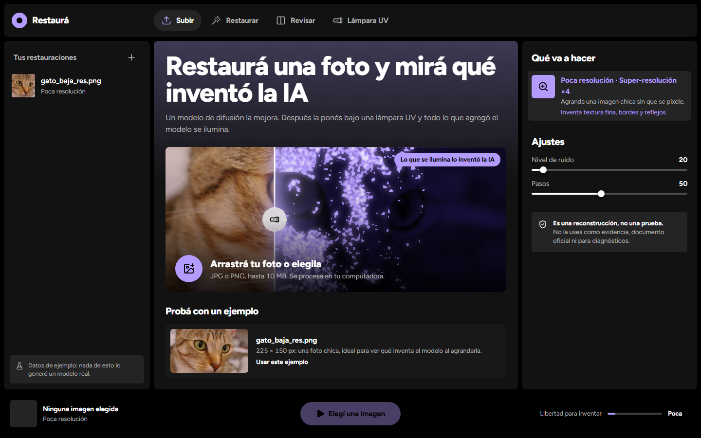
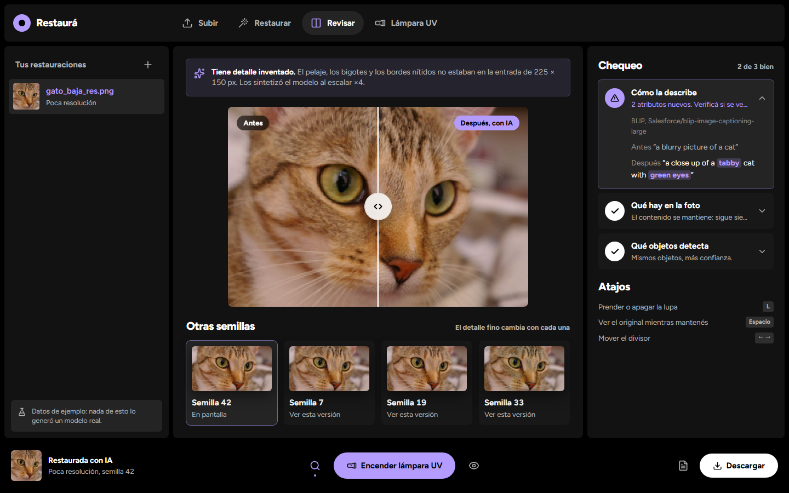
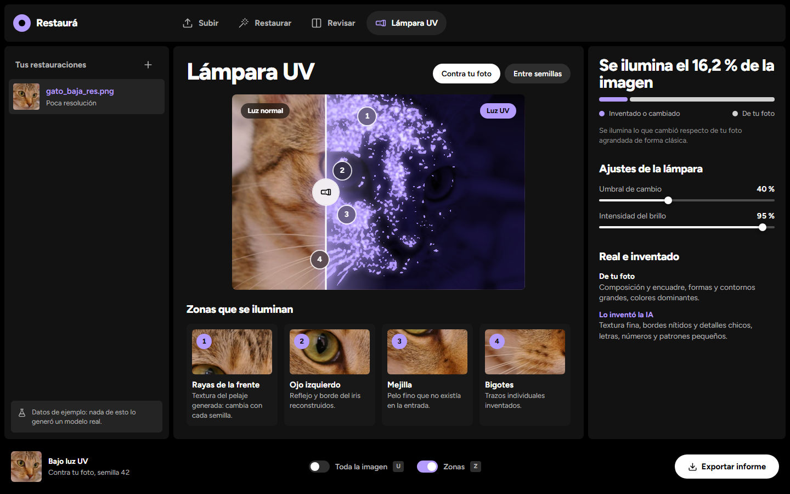

# Lámpara UV · Restauración con difusión

> Agranda ×4 una foto chica con un modelo de difusión y te muestra, como una lámpara UV sobre un cuadro restaurado, **qué parte del resultado inventó la IA**.

**Trabajo Final 2 (TP Integrador 2)** · Procesamiento Digital de Imágenes e Introducción a Visión por Computadora
**Tecnicatura Superior en Ciencia de Datos e Inteligencia Artificial** · IFTS · 2026
**Profesor:** Matías Barreto
**Sub-tarea elegida:** A, super-resolución.

**Autora:** Dominguez, Micaela Belén · [github.com/dominguezmicaela](https://github.com/dominguezmicaela)

---

## Descripción

Mucha gente guarda fotos chicas: escaneos de baja resolución, imágenes bajadas de un chat o capturas viejas. Cuando las agranda se ven pixeladas. Un modelo de difusión las puede ampliar ×4 y dejarlas nítidas, pero ese detalle nuevo **no estaba en la foto**: lo genera el modelo a partir de lo que aprendió de millones de imágenes. A simple vista, lo conservado y lo inventado no se distinguen.

Esta app hace la super-resolución con `stabilityai/stable-diffusion-x4-upscaler` y, en vez de entregar solo la imagen "linda", la acompaña con evidencia de qué cambió:

- un **mapa de diferencias** contra la entrada ampliada con bicúbica (lo que la interpolación clásica no explica lo aportó el modelo);
- un **mapa de variación entre semillas**: si cuatro corridas con semillas distintas no coinciden en una zona, ese detalle es inventado;
- un **chequeo con tres modelos de visión** (CLIP, BLIP y DETR) que compara entrada y salida: si cambió el contenido principal, la descripción o los objetos detectados, avisa;
- una **descarga marcada** con el texto "Restaurada con IA" y los parámetros guardados en los metadatos del PNG.

La metáfora es la de los restauradores de arte: bajo luz ultravioleta, lo original queda opaco y los retoques brillan. En la app, **lo que se ilumina, lo inventó el modelo**.

## Persona usuaria

**Nombre:** Laura · 45 a 55 años
**Contexto:** digitaliza el archivo familiar con un escáner viejo y el celular. Usa la compu todos los días, pero no sabe nada técnico de IA.
**Problema:** "Tengo fotos escaneadas muy chicas. Quiero agrandarlas para compartirlas, pero no quiero que el programa le cambie la cara a mi abuela sin que me dé cuenta."
**Solución actual:** apps de "mejorar foto" del celular, que dan resultados muy nítidos pero no le dicen qué inventaron.
**Cómo la ayuda esta app:** agranda la foto ×4 y le muestra, con un mapa y un aviso en palabras simples, qué partes son reconstrucción, para que decida antes de compartirla.

## Demo

**Video demo (5 min):** se suma el link cuando esté publicado.

Capturas de las cuatro pantallas (modo demo, `?demo=1`, a 1440 × 900):

| Subir | Restaurar | Revisar | Lámpara UV |
|---|---|---|---|
|  |  |  |  |

**Documentación completa:** [Especificación de Requisitos de Software (SRS)](docs/SRS.pdf) y [Manual de usuario](docs/Manual_de_usuario.pdf), en PDF.

## Qué es real y qué es inventado

**Qué hace el modelo y qué no puede recuperar.** El upscaler parte de ruido y, paso a paso, dibuja una imagen ×4 que, al achicarse, se parece a la entrada. La información que se perdió en la foto chica **ya no existe**: el modelo la reemplaza por algo **plausible**. Se conservan la composición, las formas grandes y los colores dominantes. Se inventan la textura fina (pelo, piel, tela), los bordes nítidos y, sobre todo, **letras, números y patrones chicos**.

**Cómo lo muestra la app.** Bajo la lámpara UV, lo que más cambió respecto de la bicúbica brilla en violeta. Un umbral indica qué porcentaje de la imagen cambió y se marcan las cuatro zonas de más cambio. La opción "Entre semillas" ilumina lo que difiere entre cuatro corridas: eso no puede venir de la foto.


**Qué advertencia recibe Laura.** Un aviso fijo en Revisar ("La textura fina, los bordes nítidos y los detalles chicos no estaban en la entrada… Los sintetizó el modelo"), el recordatorio "Es una reconstrucción, no una prueba" en Subir y la leyenda "Restaurada con IA" en toda descarga.

**Un ejemplo en el que el modelo inventó.** En una restauración real del gato de ejemplo (225 × 150 px, parámetros por defecto), BLIP describió la entrada como *"there is a cat that is sitting on a computer keyboard"* y la salida como *"there is a cat that is sitting on a **bed** looking at the **camera**"*: el fondo borroso se volvió una textura que se lee como una cama. CLIP subió de 0,59 a 0,93 en "foto de alta resolución", y ese salto es detalle sintetizado, no recuperado. Con el umbral en 40 %, la lámpara ilumina el **17 %** de la imagen contra la bicúbica y el **25,5 %** entre semillas, sobre todo en el pelaje de la frente.

**Cómo se puede verificar.** Ninguna métrica prueba que un detalle sea verdadero: la restauración, como mucho, llega a **creíble**. Para verificarla hace falta **evidencia externa**: el original en papel, otra foto de la misma escena con más resolución o la persona fotografiada. La app ayuda a saber **dónde** mirar, no a confirmar. Por eso, rostros, textos, matrículas y documentos ampliados **no sirven como evidencia**.

## Características

- Super-resolución ×4 con `stabilityai/stable-diffusion-x4-upscaler` (difusión latente).
- Progreso real de la difusión, paso a paso, con **fotogramas intermedios** que decodifican los latentes del VAE.
- Restauración con la semilla principal más tres **semillas extra**, para medir la variación.
- **Mapa de diferencias** (línea base bicúbica) y **mapa de variación**, con porcentaje por umbral y zonas de más cambio.
- **Verificación** con CLIP (zero-shot), BLIP (descripción) y DETR (detección de objetos).
- **Comparador** antes/después con deslizador, lupa ×2 y "mantener para ver el original".
- **Controles** de nivel de ruido y pasos, con un indicador de "libertad para inventar".
- **Historial** de restauraciones de la sesión, en una columna a la izquierda.
- Descarga de la imagen marcada y de un **informe JSON** con parámetros, porcentajes, tiempos y verificación.
- **Modo simulado** (`--simulado`) sin GPU ni modelos, y **modo demo** (`?demo=1`) con datos de ejemplo.
- Errores en lenguaje simple: imagen de más de 10 MB, formato no soportado, archivo dañado, GPU sin memoria o servidor caído.

## Tecnologías utilizadas

**Entorno:** Python 3.12 · uv · Node 20+ (solo para recompilar el frontend)
**Interfaz:** FastAPI + uvicorn (backend) · React 19 + TypeScript, Vite 8 y Tailwind CSS 4 (frontend)
**Modelos y librerías de IA:** diffusers 0.43 · transformers 5.23 · PyTorch 2.11 (CUDA 12.8) · accelerate
**Procesamiento de imágenes:** Pillow · NumPy · SciPy (`ndimage.gaussian_filter`)
**Pruebas:** pytest · ruff · Vitest · oxlint

**Modelos de IA** (todos abiertos, de Hugging Face, corren en local):

| Modelo | Para qué | Licencia |
|---|---|---|
| [`stabilityai/stable-diffusion-x4-upscaler`](https://huggingface.co/stabilityai/stable-diffusion-x4-upscaler) | Super-resolución ×4 por difusión | CreativeML Open RAIL++-M |
| [`openai/clip-vit-base-patch32`](https://huggingface.co/openai/clip-vit-base-patch32) | Clasificación zero-shot de contenido y calidad | MIT |
| [`Salesforce/blip-image-captioning-large`](https://huggingface.co/Salesforce/blip-image-captioning-large) | Descripción de entrada y salida | BSD-3-Clause |
| [`facebook/detr-resnet-50`](https://huggingface.co/facebook/detr-resnet-50) | Detección de objetos (umbral 0,7) | Apache-2.0 |

**Hardware con el que se probó:**

| Componente | Detalle |
|---|---|
| GPU | NVIDIA GeForce RTX 5060 Ti, 16 GB de VRAM (Blackwell, sm_120: por eso PyTorch para CUDA 12.8) |
| CPU | AMD Ryzen 5 7600X, 6 núcleos / 12 hilos |
| RAM | 32 GB DDR5 a 4800 MT/s |
| Sistema operativo | Windows 11 Pro |

**Tiempos medidos** con la foto de ejemplo (225 × 150 px) y los parámetros por defecto (ruido 20, 50 pasos, semilla 42 más 7, 19 y 33), con los modelos ya cargados: **51,6 s** de restauración (4 semillas × 50 pasos) y **0,6 s** de verificación. La primera restauración después de arrancar tarda más, porque carga los modelos (y, la primera vez, los descarga).

## Arquitectura del sistema

```
Persona usuaria
   │  navegador: http://127.0.0.1:8000
   ▼
Frontend React (frontend/dist, servido por la misma API)
   │  POST /api/restaurar (imagen + parámetros)       GET /api/trabajos/{id} cada 0,5 s
   ▼
API FastAPI (app/main.py) ── valida tamaño, formato y parámetros
   │
   ▼
Cola de un solo hilo (app/trabajos.py) ── nunca corren dos difusiones a la vez en la GPU
   │
   ├─► Difusión (app/pipeline/restaurar.py)
   │      reduce la entrada a ≤ 256 px de lado (múltiplos de 8)
   │      upscaler ×4 con la semilla principal (+ fotogramas intermedios) y con las semillas extra
   │
   ├─► Honestidad (app/pipeline/diferencias.py)
   │      mapa de diferencias contra la bicúbica · mapa de variación entre semillas · zonas
   │
   ├─► Análisis visual (app/pipeline/verificar.py)
   │      CLIP + BLIP + DETR sobre la entrada y la salida, y comparación
   │
   └─► Resultado: imágenes PNG en memoria + informe ─► descarga marcada / informe.json
```

| Archivo | Qué hace |
|---|---|
| `iniciar.py` | Arranque con un solo comando: compila el frontend si hace falta, levanta uvicorn y abre el navegador |
| `app/config.py` | Toda la configuración, por variables de entorno `RESTAURA_*` |
| `app/main.py` | Endpoints de la API y servido del frontend compilado |
| `app/trabajos.py` | Cola de trabajos, progreso, armado del resultado, descarga marcada e informe |
| `app/pipeline/restaurar.py` | Carga del upscaler (una sola vez), restauración, fotogramas intermedios y modo simulado |
| `app/pipeline/diferencias.py` | Mapas de diferencias y de variación, porcentajes por umbral y zonas de más cambio |
| `app/pipeline/verificar.py` | CLIP, BLIP y DETR, y comparación entre entrada y salida |
| `frontend/src/pantallas/` | Las cuatro pantallas: Subir, Restaurar, Revisar y Lámpara UV |
| `frontend/src/api.ts` | Cliente tipado de la API |
| `tests/`, `frontend/src/__tests__/` | Pruebas del backend (modo simulado e imágenes sintéticas) y del frontend |

## Instalación y ejecución

### Requisitos

- [uv](https://docs.astral.sh/uv/) (instala Python 3.12 solo).
- **Modo real:** GPU NVIDIA con 8 GB de VRAM o más. Con menos memoria, iniciá con `RESTAURA_OFFLOAD=1`. En CPU funciona, pero es muy lento.
- Unos **8 GB de disco** para los modelos, que se descargan solos de Hugging Face la primera vez. No hace falta token: ninguno es *gated*.
- Node 20+ **solo** si cambiás el frontend: el repositorio ya trae `frontend/dist` compilado.

### Pasos

```bash
git clone https://github.com/dominguezmicaela/iagen.git
cd iagen
uv sync
uv run iniciar.py
```

Se abre `http://127.0.0.1:8000`. La primera restauración tarda más porque descarga y carga los modelos.

**Sin GPU, para probar la interfaz:** `uv run iniciar.py --simulado`. La "restauración" pasa a ser un Lanczos ×4 con realce y la verificación devuelve datos fijos; la interfaz lo avisa.

**Pruebas:** `uv run pytest` (backend, sin GPU) y `cd frontend && npm ci && npm test` (frontend).

## Uso

1. En **Subir**, arrastrá tu foto (PNG, JPG o WEBP de hasta 10 MB) o tocá **Usar este ejemplo**.
2. Si querés, ajustá el nivel de ruido y los pasos. El indicador "libertad para inventar" sube con el ruido.
3. Tocá **Restaurar imagen**. En **Restaurar** ves el avance real de la difusión, los fotogramas intermedios y el tiempo restante.
4. En **Revisar** comparás antes y después con el deslizador, mirás las otras semillas y leés el chequeo de CLIP, BLIP y DETR.
5. En **Lámpara UV** pasás la lámpara sobre la foto: lo que brilla lo inventó el modelo. Podés cambiar entre "Contra tu foto" y "Entre semillas".
6. Descargá la imagen marcada o el informe JSON.

Las capturas de cada paso están en [Demo](#demo) y, con más detalle, en el [Manual de usuario](docs/Manual_de_usuario.pdf).

## Decisiones de diseño

### Por qué FastAPI + React y no Gradio

La consigna recomienda Gradio y también admite un frontend propio. Elegí FastAPI + React porque el centro del proyecto es una interacción que Gradio no trae: una **lámpara UV arrastrable** que revela el mapa sobre la foto, el progreso real paso a paso con fotogramas y las semillas lado a lado. Igual se ejecuta con un solo comando (`uv run iniciar.py`) y corre todo en local. Como costo, hay más código y el frontend hay que compilarlo; por eso el build va incluido en el repo.

### Por qué el upscaler ×4 de Stable Diffusion

Es el modelo de difusión de referencia para la sub-tarea A, entra cómodo en 16 GB en `float16` y tiene licencia abierta. Corre en local sin token. El VAE se carga en `float32` porque en `float16` puede dar imágenes negras. La entrada se limita a 256 px de lado: la salida queda en 1024 px, el rango para el que fue entrenado, y la memoria se mantiene acotada.

### Por qué CLIP, BLIP y DETR

Cada uno contesta una pregunta distinta de Laura:
- **CLIP**: "¿sigue siendo la misma foto?". Clasifica entrada y salida entre tipos de contenido y de calidad. Solo se usa para **comparar**, no como juez absoluto.
- **BLIP**: "¿qué ve una máquina?". Describe entrada y salida, y la app resalta las **palabras nuevas**: son detalles para verificar.
- **DETR**: "¿aparecieron o desaparecieron cosas?". Compara los objetos detectados con confianza mayor a 0,7.

Los tres se equivocan, y la app lo dice: sus resultados son **alertas para mirar**, nunca una prueba.

### Principios de Human-AI Interaction aplicados

**Transparencia:** no hay *spinner* mudo. Se ven la etapa real, el paso actual de la difusión, los fotogramas y el tiempo restante.
**Control:** nivel de ruido y pasos, con una traducción a "libertad para inventar". Comparador, lupa, "mantener para ver el original" y umbral de la lámpara.
**Explicabilidad:** el aviso dice en palabras qué inventó el modelo. Los mapas y las zonas muestran **dónde**, y el chequeo explica **por qué** hay una alerta.
**Honestidad sobre lo generado:** la descarga lleva la leyenda "Restaurada con IA" y los metadatos con modelo, semilla y parámetros. La imagen no viaja sin su aclaración.
**Manejo de errores:** mensajes en lenguaje simple con qué hacer ("La imagen pesa más de 10 MB", "La GPU se quedó sin memoria. Probá con RESTAURA_OFFLOAD=1 o con menos pasos", "No hay conexión con el servidor").

## Conceptos de procesamiento digital aplicados

| Concepto | Dónde |
|---|---|
| **Muestreo e interpolación** (bicúbica, Lanczos) | La bicúbica es la **línea base** del mapa de diferencias (`diferencias.py`). Lanczos reduce la entrada (`restaurar.py`) y hace el ×4 del modo simulado. |
| **Resolución espacial** | Reducción de la entrada a ≤ 256 px, en múltiplos de 8 por la estructura latente del VAE, y ampliación ×4 (`preparar_entrada`). |
| **Diferencia de imágenes** | Error absoluto por píxel, promediado en los tres canales RGB (`mapa_diferencias`). |
| **Filtro gaussiano** (pasa-bajos) | Suaviza los mapas antes de normalizarlos (σ = 1) y para buscar las zonas (σ = 4 % del lado) (`_mapa`, `zonas`). |
| **Normalización y umbralización** | Normalización por el percentil 99,5 y porcentaje de píxeles sobre 19 umbrales (5 % a 95 %), que alimentan el deslizador de la lámpara. |
| **Estadística entre imágenes** | Desvío estándar por píxel entre las salidas de distintas semillas (`mapa_variacion`). |
| **Búsqueda de máximos locales** | Zonas de más cambio: máximo, supresión de un entorno del 15 % y repetición (`zonas`). |
| **Filtro de realce** (máscara de enfoque) | `UnsharpMask` en el modo simulado; desenfoque gaussiano decreciente para simular los fotogramas. |
| **Espacios de color y canales** | Conversión a RGB de toda entrada (incluso PNG con transparencia o en escala de grises); mapas en escala de grises (modo `L`); composición RGBA para la marca de agua. |

## Uso de agentes de IA

**Herramienta utilizada:** **Claude Code** como agente de programación, en commits chicos con pruebas por cada parte (ver el historial). Las instrucciones para el agente están en [`AGENTS.md`](AGENTS.md).

**Qué decidí yo:**
- La sub-tarea A (super-resolución) y la persona usuaria: alguien que digitaliza fotos familiares y no sabe de IA.
- La metáfora de la lámpara UV como centro de la interfaz.
- Verificar con tres modelos (CLIP, BLIP y DETR) y con semillas extra, en vez de mostrar solo la imagen final.
- FastAPI + React en lugar de Gradio, para poder armar la lámpara arrastrable y el progreso paso a paso.

**Qué propuso el agente:**
- Una cola de un solo hilo, para que nunca corran dos difusiones a la vez en la GPU.
- Cargar el VAE en `float32`, porque en `float16` puede dar imágenes negras.
- Decodificar los latentes durante la difusión para mostrar los fotogramas intermedios.
- Un modo simulado, para probar la app y correr las pruebas sin GPU ni modelos.

**Cómo lo revisé:** probé cada pantalla en el navegador y con restauraciones reales en mi GPU, corrí las pruebas del backend y del frontend en cada cambio, y pedí correcciones cuando algo no me convencía.

**Qué descarté y por qué:** las opciones para eliminar ruido y restaurar fotos antiguas (sub-tareas B y C). Llegaron a estar en la interfaz como "Próximamente", pero las saqué: no estaban implementadas, y un MVP no debe mostrar funcionalidades a medio hacer.

## Limitaciones conocidas

- **Solo super-resolución** (sub-tarea A).
- **Funciona mejor con fotos chicas**: la entrada se limita a 256 px de lado (128 en CPU); una foto más grande se achica antes y pierde detalle real.
- **Tiempo de procesamiento:** alrededor de un minuto con GPU (cuatro semillas). En CPU puede tardar muchos minutos.
- **Tamaño máximo de archivo:** 10 MB.
- **No sirve para rostros, textos, matrículas ni documentos como evidencia**: lo que muestra es verosímil, no verificado.
- **El mapa de diferencias mide cambio, no invención.** Una zona puede cambiar por una mejora legítima de nitidez, y la bicúbica de referencia también es una estimación.
- **CLIP, BLIP y DETR se equivocan.** BLIP describe en inglés y CLIP no fue entrenado para medir calidad.
- **Los trabajos viven en memoria:** se guardan los últimos 10 y se pierden al reiniciar. Un solo usuario a la vez, sin autenticación, pensado para `127.0.0.1`.

## Trabajo futuro

- [ ] Sub-tareas B (ruido y desenfoque) y C (fotos antiguas) con un segundo modelo de difusión.
- [ ] Métricas cuantitativas (PSNR, SSIM, LPIPS) explicadas en lenguaje simple.
- [ ] Notebook de Google Colab para quien no tenga GPU.
- [ ] Procesamiento por lotes para digitalizar un álbum completo.
- [ ] Descripciones en español.

## Reflexiones y aprendizajes

Construirlo cambió cómo miro una foto "mejorada": una imagen nítida no es una imagen más verdadera. El modelo no recupera lo que se perdió, lo imagina, y lo hace tan bien que a simple vista no se nota. Por eso el trabajo más importante no fue que la foto se viera bien, sino mostrar con evidencia dónde está lo inventado y decirlo en palabras que entienda alguien sin formación técnica.

En lo técnico, los desafíos fueron hacer correr el modelo en una GPU nueva (lo que obligó a usar PyTorch para CUDA 12.8), evitar que dos difusiones compitieran por la memoria y mostrar el progreso real en lugar de una espera muda. Trabajar con un agente de IA aceleró mucho la programación, pero me obligó a revisar cada cambio, probarlo con imágenes reales y decidir qué entraba y qué no.

## Recursos y referencias

- [Ficha de `stabilityai/stable-diffusion-x4-upscaler`](https://huggingface.co/stabilityai/stable-diffusion-x4-upscaler) y [documentación de diffusers](https://huggingface.co/docs/diffusers)
- Fichas de [CLIP](https://huggingface.co/openai/clip-vit-base-patch32), [BLIP](https://huggingface.co/Salesforce/blip-image-captioning-large) y [DETR](https://huggingface.co/facebook/detr-resnet-50), y [documentación de transformers](https://huggingface.co/docs/transformers)
- [Documentación de uv](https://docs.astral.sh/uv/), [FastAPI](https://fastapi.tiangolo.com/) y [React](https://react.dev/)
- Consigna del Trabajo Integrador N.º 2 de la materia

## Licencia

El código de este repositorio se publica con licencia [MIT](LICENSE). Los modelos conservan sus propias licencias (ver la tabla de [Tecnologías utilizadas](#tecnologías-utilizadas)); en particular, el upscaler se rige por CreativeML Open RAIL++-M, que prohíbe usos engañosos o dañinos de las imágenes generadas.

---

**Trabajo Integrador N.º 2 · IFTS · 2026**
