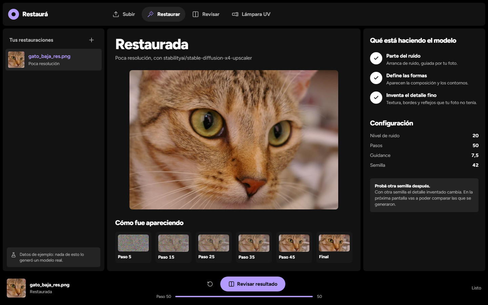

# Lámpara UV · Restauración con difusión

> Agranda ×4 una foto chica con un modelo de difusión y te muestra, como una lámpara UV sobre un cuadro restaurado, **qué parte del resultado inventó la IA**.

**TP Integrador 2** · Procesamiento Digital de Imágenes e Introducción a Visión por Computadora · IFTS 24 · 2026
**Sub-tarea elegida:** A, super-resolución.

<!-- TODO: completá con tu nombre y tu GitHub -->
**Autora:** _[Apellido, Nombre]_ · [github.com/dominguezmicaela](https://github.com/dominguezmicaela)

---

## Descripción

Mucha gente guarda fotos chicas: escaneos de baja resolución, imágenes bajadas de un chat o capturas viejas. Cuando las agranda se ven pixeladas. Un modelo de difusión las puede ampliar ×4 y dejarlas nítidas, pero ese detalle nuevo **no estaba en la foto**: lo genera el modelo a partir de lo que aprendió de millones de imágenes. A simple vista, lo conservado y lo inventado no se distinguen.

Esta app hace la super-resolución con `stabilityai/stable-diffusion-x4-upscaler` y, en vez de entregar solo la imagen "linda", la acompaña con evidencia de qué cambió:

- un **mapa de diferencias** contra la entrada ampliada con bicúbica (lo que la interpolación clásica no explica lo aportó el modelo);
- un **mapa de variación entre semillas**: si cuatro corridas con semillas distintas no coinciden en una zona, ese detalle es inventado;
- un **chequeo con tres modelos de visión** (CLIP, BLIP y DETR) que compara entrada y salida por separado: si cambió el contenido principal, la descripción o los objetos detectados, avisa;
- una **descarga marcada** con el texto "Restaurada con IA" y los parámetros guardados en los metadatos del PNG.

La metáfora es la de los restauradores de arte: bajo luz ultravioleta, lo original queda opaco y los retoques brillan. En la app, **lo que se ilumina, lo inventó el modelo**.

## Persona usuaria

<!-- TODO: revisá que esta persona sea la tuya; es la que se desprende de cómo está armada la app. -->

**Nombre:** Laura · 45 a 55 años
**Contexto:** digitaliza el archivo familiar con un escáner viejo y el celular. Usa la compu todos los días, pero no sabe nada técnico de IA.
**Problema:** "Tengo fotos escaneadas muy chicas. Quiero agrandarlas para compartirlas, pero no quiero que el programa le cambie la cara a mi abuela sin que me dé cuenta."
**Solución actual:** apps de "mejorar foto" del celular, que dan resultados muy nítidos pero no le dicen qué inventaron.
**Cómo la ayuda esta app:** agranda la foto ×4 y le muestra, con un mapa y un aviso en palabras simples, qué partes son reconstrucción, para que decida antes de compartirla.

## Demo

<!-- TODO: link al video de 5 minutos (YouTube, Vimeo, Loom o Drive, sin iniciar sesión) -->
**Video demo (5 min):** _[link]_

<!-- TODO: capturas en docs/capturas/ -->
| Subir | Restaurar | Revisar | Lámpara UV |
|---|---|---|---|
|  |  |  |  |

## Qué es real y qué es inventado

**Qué hace el modelo.** El upscaler ×4 recibe la foto chica y un *prompt* ("a high quality photo"). Parte de ruido y, en cada paso de difusión, dibuja una imagen grande que, al achicarse, se parece a la entrada. No "recupera" píxeles perdidos: la información que no sobrevivió a la baja resolución **ya no existe**, y el modelo la reemplaza por algo **plausible**.

**Qué se conserva (dato):** la composición y el encuadre, las formas y los contornos grandes, y los colores dominantes. Todo eso ya estaba en los píxeles de entrada.
**Qué se inventa (invento):** la textura fina (pelo, piel, tela), los bordes nítidos, los detalles chicos y, sobre todo, **letras, números y patrones pequeños**.

**Cómo lo muestra la app.**
1. **Aviso fijo** en la pantalla de resultados: "La textura fina, los bordes nítidos y los detalles chicos no estaban en la entrada de *N × M px*. Los sintetizó el modelo al escalar ×4".
2. **Lámpara UV**: el mapa de diferencias se superpone a la foto y lo que más cambió brilla. Un deslizador de umbral muestra qué porcentaje de la imagen cambió más que cierto valor. También marca las cuatro **zonas de más cambio**.
3. **Otras semillas**: la misma foto restaurada con cuatro semillas. Lo que cambia entre ellas no puede ser dato, porque el dato es el mismo para todas.
4. **Chequeo**: CLIP (¿sigue siendo la misma clase de foto?), BLIP (¿la descripción suma palabras nuevas?) y DETR (¿aparecieron o desaparecieron objetos?).
5. **Descarga marcada**: la imagen exportada lleva la leyenda "Restaurada con IA" y, en los metadatos PNG, el modelo, la semilla y los parámetros.

**Un ejemplo en el que el modelo inventó.**
<!-- TODO: reemplazá con un caso real tuyo (captura + qué pasó). -->
_[Por ejemplo: en la foto del gato, BLIP describe la entrada como "a blurry picture of an animal" y la salida como "a close up of a tabby cat with green eyes". El color de ojos y el atigrado no se pueden ver en la entrada de 225 × 150 px: los aportó el modelo. Entre semillas, el dibujo del pelaje cambia.]_

**Cómo se puede verificar.** Ninguna métrica prueba que un detalle sea verdadero: la restauración, como mucho, llega a **creíble**. Para verificarla hace falta **evidencia externa**: otra foto de la misma escena con más resolución, el negativo o el original en papel, o la persona fotografiada. La app ayuda a saber **dónde** mirar (zonas de más cambio y de más variación), no a confirmar.

**Rostros, textos, matrículas y documentos.** No es aceptable usar el resultado como evidencia. Un rostro ampliado es *una* cara verosímil, no *la* cara. Una matrícula o un texto ampliados pueden mostrar letras que nunca estuvieron. La app no bloquea estos casos, pero el aviso y la descarga marcada dejan claro que la imagen es una reconstrucción.

## Características

- Super-resolución ×4 con `stabilityai/stable-diffusion-x4-upscaler` (difusión latente).
- Progreso real de la difusión, paso a paso, con **fotogramas intermedios** que decodifican los latentes del VAE durante el proceso.
- Restauración con la semilla principal más hasta tres **semillas extra**, para medir la variación.
- **Mapa de diferencias** y **mapa de variación**, con porcentaje de imagen por umbral y zonas de más cambio.
- **Verificación** con CLIP (zero-shot), BLIP (descripción) y DETR (detección de objetos).
- **Comparador** antes/después con deslizador, lupa ×2 y "mantener para ver el original".
- **Controles** de nivel de ruido, pasos y *guidance*, con un indicador de "libertad para inventar".
- **Historial** de restauraciones de la sesión en la barra lateral.
- Descarga de la imagen marcada y de un **informe JSON** con parámetros, porcentajes, tiempos y verificación.
- **Modo simulado** (`--simulado`) sin GPU ni modelos, y **modo demo** del frontend (`?demo=1`) con datos de ejemplo.
- Errores en lenguaje simple: imagen de más de 10 MB, formato no soportado, archivo dañado, GPU sin memoria o servidor caído.

## Tecnologías utilizadas

**Entorno:** Python 3.12 · uv · Node 20+ (solo para recompilar el frontend)
**Backend:** FastAPI + uvicorn · diffusers 0.43 · transformers 5.23 · PyTorch 2.11 (CUDA 12.8) · accelerate
**Frontend:** React 19 + TypeScript · Vite 8 · Tailwind CSS 4 · lucide-react
**Procesamiento de imágenes:** Pillow · NumPy · SciPy (`ndimage.gaussian_filter`)
**Pruebas:** pytest · ruff · Vitest · oxlint

**Modelos de IA** (todos abiertos, de Hugging Face, corren en local):

| Modelo | Para qué | Licencia |
|---|---|---|
| [`stabilityai/stable-diffusion-x4-upscaler`](https://huggingface.co/stabilityai/stable-diffusion-x4-upscaler) | Super-resolución ×4 por difusión | CreativeML Open RAIL++-M |
| [`openai/clip-vit-base-patch32`](https://huggingface.co/openai/clip-vit-base-patch32) | Clasificación zero-shot de contenido y calidad | MIT |
| [`Salesforce/blip-image-captioning-large`](https://huggingface.co/Salesforce/blip-image-captioning-large) | Descripción de entrada y salida | BSD-3-Clause |
| [`facebook/detr-resnet-50`](https://huggingface.co/facebook/detr-resnet-50) | Detección de objetos (umbral 0,7) | Apache-2.0 |

**Hardware con el que se probó:** NVIDIA GeForce RTX 5060 Ti con 16 GB de VRAM (Blackwell, sm_120, por eso las ruedas de PyTorch para CUDA 12.8) · Windows 11 Pro.
<!-- TODO: agregá RAM y CPU, y los tiempos reales que te dio (están en el informe JSON: tiempos.restauracion_s y tiempos.verificacion_s). -->

## Arquitectura del sistema

```
Persona usuaria
   │  navegador: http://127.0.0.1:8000
   ▼
Frontend React (frontend/dist, servido por la misma API)
   │  POST /api/restaurar (imagen + parámetros)       GET /api/trabajos/{id} cada 0,5 s
   ▼
API FastAPI (app/main.py) ── valida tamaño, formato y parámetros
   │
   ▼
Cola de un solo hilo (app/trabajos.py) ── nunca corren dos difusiones a la vez en la GPU
   │
   ├─► Difusión (app/pipeline/restaurar.py)
   │      reduce la entrada a ≤ 256 px de lado (múltiplos de 8)
   │      upscaler ×4 con la semilla principal (+ fotogramas intermedios) y con las semillas extra
   │
   ├─► Honestidad (app/pipeline/diferencias.py)
   │      mapa de diferencias contra la bicúbica · mapa de variación entre semillas · zonas
   │
   ├─► Análisis visual (app/pipeline/verificar.py)
   │      CLIP + BLIP + DETR sobre la entrada y la salida, y comparación
   │
   └─► Resultado: imágenes PNG en memoria + informe ─► descarga marcada / informe.json
```

| Archivo | Qué hace |
|---|---|
| `iniciar.py` | Arranque con un solo comando: compila el frontend si hace falta, levanta uvicorn y abre el navegador |
| `app/config.py` | Toda la configuración por variables de entorno |
| `app/main.py` | Endpoints de la API y servido del frontend compilado |
| `app/trabajos.py` | Cola de trabajos, progreso, armado del resultado, descarga marcada e informe |
| `app/pipeline/restaurar.py` | Carga perezosa del upscaler, restauración, fotogramas intermedios, modo simulado y una CLI |
| `app/pipeline/diferencias.py` | Mapas de diferencias y de variación, porcentajes por umbral y zonas de más cambio |
| `app/pipeline/verificar.py` | CLIP, BLIP y DETR, y comparación entre entrada y salida |
| `frontend/src/pantallas/` | Las cuatro pantallas: Subir, Restaurar, Revisar y Lámpara UV |
| `frontend/src/api.ts` | Cliente tipado de la API |
| `tests/`, `frontend/src/__tests__/` | Pruebas del backend (modo simulado e imágenes sintéticas) y del frontend |

## Instalación y ejecución

### Requisitos

- [uv](https://docs.astral.sh/uv/) (instala Python 3.12 solo).
- **Modo real:** GPU NVIDIA con 8 GB de VRAM o más. Con menos memoria, usá `RESTAURA_OFFLOAD=1`. En CPU funciona, pero es muy lento y usa entradas de 128 px.
- Unos **8 GB de disco** para los modelos, que se descargan solos de Hugging Face la primera vez. No hace falta token: ninguno de los modelos es *gated*.
- Node 20+ **solo** si cambiás el frontend: el repositorio ya trae `frontend/dist` compilado.

### Pasos

```bash
git clone https://github.com/dominguezmicaela/iagen.git
cd iagen
uv sync
uv run iniciar.py
```

Se abre `http://127.0.0.1:8000`. La primera restauración tarda más porque descarga y carga los modelos.

**Sin GPU, para probar la interfaz:**

```bash
uv run iniciar.py --simulado
```

En este modo, la "restauración" es un Lanczos ×4 con realce y la verificación devuelve datos fijos. Se avisa en la interfaz.

**Desde la terminal, sin interfaz:**

```bash
uv run python -m app.pipeline.restaurar foto.png --seed 42 --steps 50
```

### Variables de entorno

| Variable | Por defecto | Para qué |
|---|---|---|
| `RESTAURA_SIMULADO` | `0` | `1` = sin modelos (lo mismo que `--simulado`) |
| `RESTAURA_OFFLOAD` | `0` | `1` = `enable_model_cpu_offload()` para GPUs con poca VRAM |
| `RESTAURA_MAX_LADO` | `256` en GPU, `128` en CPU | Lado máximo de la entrada (la salida es ×4) |
| `RESTAURA_SEMILLAS_EXTRA` | `7,19,33` en GPU, ninguna en CPU | Semillas extra para el mapa de variación |
| `RESTAURA_DETR` | `1` en GPU, `0` en CPU | Activar la detección de objetos |
| `RESTAURA_PRECARGAR` | `0` | `1` = cargar los modelos al arrancar, no en la primera restauración |

### Pruebas

```bash
uv run pytest            # backend, en modo simulado y con imágenes sintéticas
uv run ruff check .
cd frontend && npm ci && npm test
```

### Desarrollo del frontend

```bash
uv run uvicorn app.main:app --reload     # API en :8000
cd frontend && npm run dev               # Vite en :5173, con proxy de /api
```

Con `?demo=1` en la URL, el frontend usa los datos de ejemplo de `frontend/src/datos/ejemplo.ts` y no necesita el backend.

## Uso

1. Abrí la app. En **Subir**, arrastrá tu foto (PNG, JPG o WEBP de hasta 10 MB) o elegí un ejemplo.
2. Si querés, ajustá los parámetros. El indicador "libertad para inventar" sube con el nivel de ruido.
3. Tocá **Restaurar**. En **Restaurar** ves el avance real de la difusión, los fotogramas intermedios y el tiempo restante.
4. En **Revisar** comparás antes y después con el deslizador, mirás las otras semillas y leés el chequeo de CLIP, BLIP y DETR.
5. En **Lámpara UV** pasás la lámpara sobre la foto: lo que brilla lo inventó el modelo. Podés cambiar entre "contra tu foto" y "entre semillas".
6. Descargá la imagen marcada o el informe JSON.

## Decisiones de diseño

### Por qué FastAPI + React y no Gradio

La consigna recomienda Gradio y también admite **FastAPI con un frontend propio**. Elegí la segunda opción porque el centro del proyecto es una interacción que Gradio no trae: una **lámpara UV arrastrable** que revela el mapa de diferencias sobre la foto, el progreso real paso a paso con fotogramas y las semillas lado a lado. Igual se ejecuta con un solo comando (`uv run iniciar.py`) y corre todo en local. Como costo, hay más código y el frontend hay que compilarlo; por eso el build va incluido en el repo.

### Por qué el upscaler ×4 de Stable Diffusion

Es el modelo de difusión de referencia para la sub-tarea A, entra cómodo en 16 GB en `float16` y tiene licencia abierta. Corre en local sin token. El VAE se carga en `float32` porque en `float16` puede dar imágenes negras. La entrada se limita a 256 px de lado: la salida queda en 1024 px, que es el rango para el que fue entrenado, y la memoria se mantiene acotada.

### Por qué CLIP, BLIP y DETR

Cada uno contesta una pregunta distinta de Laura:
- **CLIP**: "¿sigue siendo la misma foto?". Clasifica entrada y salida entre siete tipos de contenido y dos de calidad. Solo se usa para **comparar**, no como juez absoluto.
- **BLIP**: "¿qué ve una máquina?". Describe entrada y salida, y la app resalta las **palabras nuevas** de la segunda descripción: son detalles para verificar.
- **DETR**: "¿aparecieron o desaparecieron cosas?". Compara los objetos detectados con confianza mayor a 0,7.

Los tres modelos se equivocan, y la app lo dice: sus resultados son **alertas para mirar**, nunca una prueba.

### Principios de Human-AI Interaction aplicados

**Transparencia:** no hay *spinner* mudo. Se ven la etapa real ("Inventa el detalle fino", "Prueba otra semilla", "Verifica con CLIP, BLIP y DETR"), el paso actual de la difusión, los fotogramas y el tiempo restante.
**Control:** nivel de ruido, pasos y *guidance*, con una traducción a "libertad para inventar". Comparador, lupa, "mantener para ver el original" y umbral de la lámpara.
**Explicabilidad:** el aviso dice en palabras qué inventó el modelo. Los mapas y las zonas muestran **dónde**, y el chequeo explica **por qué** hay una alerta.
**Honestidad en la salida:** la descarga lleva la leyenda "Restaurada con IA" y los metadatos con modelo, semilla y parámetros. La imagen no viaja sin su aclaración.
**Manejo de errores:** mensajes en lenguaje simple con qué hacer ("La imagen pesa más de 10 MB", "La GPU se quedó sin memoria. Probá con RESTAURA_OFFLOAD=1 o con menos pasos", "No hay conexión con el servidor").

## Conceptos de procesamiento digital aplicados

| Concepto | Dónde |
|---|---|
| **Muestreo e interpolación** (bicúbica, Lanczos) | La bicúbica es la **línea base** del mapa de diferencias (`diferencias.py`). Lanczos reduce la entrada (`restaurar.py`) y hace el ×4 del modo simulado. |
| **Resolución espacial** | Reducción de la entrada a ≤ 256 px, en múltiplos de 8 por la estructura latente del VAE, y ampliación ×4 (`preparar_entrada`). |
| **Diferencia de imágenes** | Error absoluto por píxel, promediado en los tres canales RGB (`mapa_diferencias`). |
| **Filtro gaussiano** (pasa-bajos) | Suaviza los mapas antes de normalizarlos (σ = 1) y para buscar las zonas (σ = 4 % del lado) (`_mapa`, `zonas`). |
| **Normalización y umbralización** | Normalización por el percentil 99,5 y porcentaje de píxeles sobre 19 umbrales (5 % a 95 %), que alimentan el deslizador de la lámpara. |
| **Estadística entre imágenes** | Desvío estándar por píxel entre las salidas de distintas semillas (`mapa_variacion`). |
| **Búsqueda de máximos locales** | Zonas de más cambio: máximo, supresión de un entorno del 15 % y repetición (`zonas`). |
| **Filtro de realce** (máscara de enfoque) | `UnsharpMask` en el modo simulado; desenfoque gaussiano decreciente para simular los fotogramas. |
| **Espacios de color y canales** | Conversión a RGB de toda entrada (incluso PNG con transparencia o en escala de grises); mapas en escala de grises (modo `L`); composición RGBA para la marca de agua. |

## Uso de agentes de IA

Desarrollé el proyecto con **Claude Code** como agente de programación, en commits chicos con pruebas por cada parte (ver el historial).

<!-- TODO: completá con tus palabras. Es lo que se evalúa en la defensa. -->
**Qué decidí yo:**
- _[sub-tarea A y la persona]_
- _[la metáfora de la lámpara UV y la estética]_
- _[usar tres modelos de verificación y semillas extra]_
- _[FastAPI + React en lugar de Gradio]_
- _[...]_

**Qué propuso el agente:**
- _[por ejemplo: cola de un solo hilo para la GPU, VAE en float32, decodificar latentes para los fotogramas, modo simulado para probar sin GPU]_
- _[...]_

**Cómo lo revisé:** _[leer cada diff, correr las pruebas, probar con mis imágenes, qué descarté]_.

Las instrucciones para el agente están en [`AGENTS.md`](AGENTS.md).

## Limitaciones conocidas

- **Solo sub-tarea A.** La interfaz muestra B y C (ruido y foto antigua) como "Próximamente"; solo se pueden recorrer en el modo demo, con datos de ejemplo.
- **Entrada máxima de 256 px de lado** (128 en CPU): una foto más grande se achica antes de restaurarla, así que pierde detalle real.
- **Lento sin GPU.** En CPU, una restauración puede tardar muchos minutos. Con GPU, cuatro semillas multiplican el tiempo por cuatro.
- **Los trabajos viven en memoria.** Se guardan los últimos 10 y se pierden al reiniciar el servidor. No hay base de datos (no la pide la consigna).
- **El mapa de diferencias mide cambio, no invención.** Una zona puede cambiar por una mejora legítima de nitidez. Y la bicúbica de referencia también es una estimación.
- **CLIP, BLIP y DETR se equivocan y "alucinan".** BLIP describe en inglés. CLIP no fue entrenado para medir calidad.
- **Ninguna verificación es prueba.** El sistema muestra dónde mirar. Verificar requiere una fuente externa.
- **Un solo usuario a la vez.** La cola procesa de a un trabajo, y la API no tiene autenticación: está pensada para correr en `127.0.0.1`.

## Preguntas frecuentes

**¿Mi foto sale de mi compu?** No. Todo corre en local; internet solo se usa la primera vez, para bajar los modelos.
**¿Por qué cada semilla da un resultado distinto?** Porque el detalle fino lo inventa el modelo partiendo de ruido aleatorio. Lo que coincide entre semillas viene de tu foto.
**¿Puedo usar el resultado como prueba de algo?** No. Es una reconstrucción creíble, no un registro verificable.
